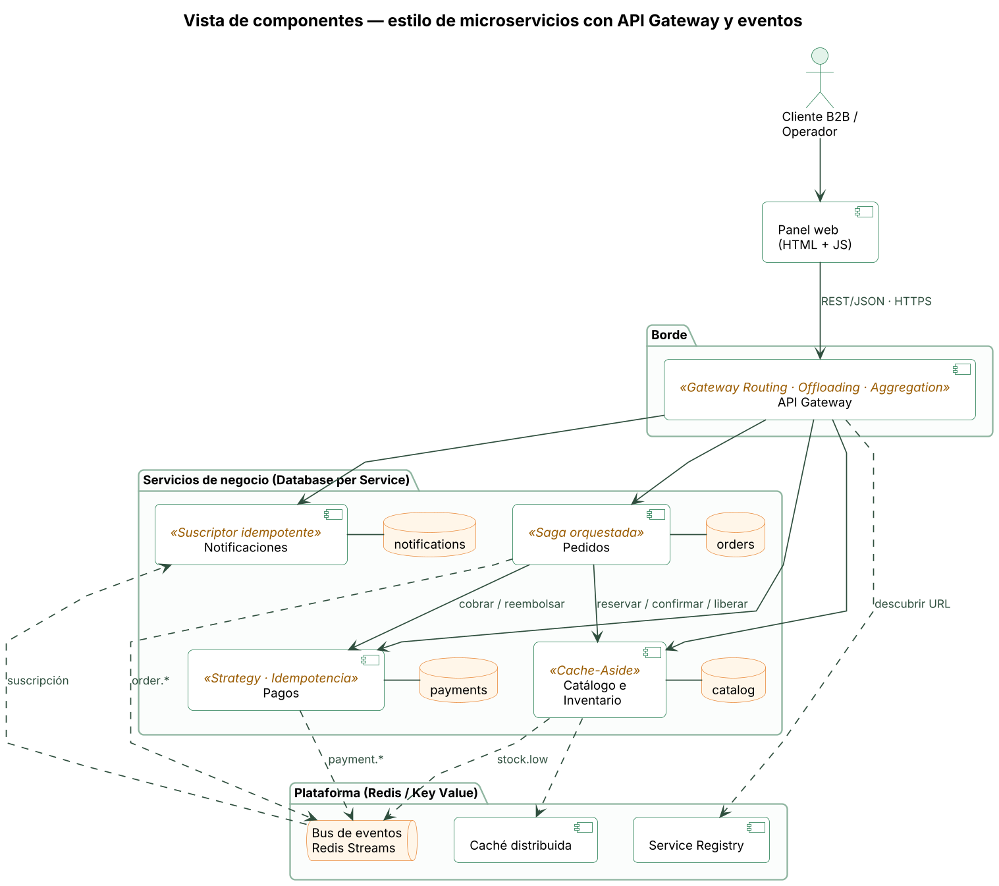

# FrescoRuta Cloud

[](https://github.com/<usuario>/frescoruta-cloud/actions/workflows/ci.yml)


Prototipo funcional de una **arquitectura de microservicios en la nube** para
**FrescoRuta S.A.S.**, empresa ficticia que distribuye alimentos frescos a
restaurantes, tiendas y hoteles de Bogotá, Medellín y Cali.

Proyecto del curso **Arquitectura de Software** — Actividad 2 *“Orquestando
códigos: la sinfonía de los sistemas”*.

> Reemplace `<usuario>` por su usuario u organización de GitHub en los enlaces
> de esta página después de publicar el repositorio.

---

## Contenido

1. [Problema y objetivo](#1-problema-y-objetivo)
2. [Arquitectura](#2-arquitectura)
3. [Patrones de diseño implementados](#3-patrones-de-diseño-implementados)
4. [Estructura del repositorio](#4-estructura-del-repositorio)
5. [Ejecución local](#5-ejecución-local)
6. [Despliegue en Render](#6-despliegue-en-render)
7. [Guion de demostración](#7-guion-de-demostración)
8. [API pública (vía gateway)](#8-api-pública-vía-gateway)
9. [Pruebas e integración continua](#9-pruebas-e-integración-continua)
10. [Configuración](#10-configuración)
11. [Decisiones de arquitectura](#11-decisiones-de-arquitectura)
12. [Limitaciones y trabajo futuro](#12-limitaciones-y-trabajo-futuro)
13. [Equipo](#13-equipo)

---

## 1. Problema y objetivo

FrescoRuta opera hoy con un **monolito PHP on-premise** y una única base de
datos MySQL. Los pedidos llegan por WhatsApp y llamadas, el inventario se
desactualiza (≈ 8 % de pedidos con faltantes), el sistema se cae en los picos
de los viernes y de diciembre, y cada despliegue exige una ventana de
mantenimiento.

El objetivo del prototipo es demostrar una arquitectura **modular, escalable y
resiliente**, desplegable en la nube, que:

* reciba pedidos en línea sin sobreventa de inventario;
* mantenga la consistencia entre inventario, pagos y pedidos **sin una
  transacción distribuida** (Saga);
* siga funcionando —degradada pero sin corromper datos— cuando falla la
  pasarela de pagos (Retry + Circuit Breaker);
* notifique a clientes y compras de forma **asíncrona** (eventos);
* se despliegue con **infraestructura como código** y CI.

## 2. Arquitectura



| Servicio | Puerto local | Responsabilidad | Datos propios | Patrones destacados |
|---|---|---|---|---|
| `api-gateway` | 8000 | Punto único de entrada, panel web | — | Gateway Routing/Offloading/Aggregation, Rate Limiting, API Key |
| `catalog-service` | 8001 | Productos, stock, reservas | `catalog.db` | Repository, Cache-Aside, reservas atómicas |
| `order-service` | 8002 | Pedidos y orquestación | `orders.db` | Saga orquestada, Circuit Breaker, Retry, Idempotency Key |
| `payment-service` | 8003 | Autorización de pagos | `payments.db` | Strategy, Factory, Idempotencia, Fault Injection |
| `notification-service` | 8004 | Correo / WhatsApp (simulados) | `notifications.db` | Publish/Subscribe, consumidor idempotente |
| Redis / Render Key Value | 6379 | Broker, caché y registro | — | Redis Streams, Competing Consumers, DLQ, Service Registry |

Diagramas UML completos en [`docs/uml`](docs/uml):
[casos de uso](docs/uml/casos-de-uso.png) ·
[clases (dominio)](docs/uml/clases-dominio.png) ·
[clases (chasis)](docs/uml/clases-chasis.png) ·
[secuencia de la saga](docs/uml/secuencia-crear-pedido.png) ·
[despliegue](docs/uml/despliegue.png).
La explicación detallada está en [`docs/arquitectura.md`](docs/arquitectura.md).

## 3. Patrones de diseño implementados

| Patrón | Dónde | Problema que resuelve |
|---|---|---|
| **Microservicios + Database per Service** | `services/*` | Despliegue y escalado independiente; aislamiento de fallas |
| **API Gateway** (Routing, Offloading, Aggregation) | [`gateway_service/api.py`](services/gateway/gateway_service/api.py), [`routes.py`](services/gateway/gateway_service/routes.py) | Un solo punto de entrada; seguridad y observabilidad centralizadas; oculta endpoints internos |
| **Rate Limiting / Throttling** (Token Bucket) | [`ratelimit.py`](services/gateway/gateway_service/ratelimit.py) | Protege los servicios de picos y abusos (HTTP 429) |
| **Saga orquestada** + transacciones de compensación | [`order_service/saga.py`](services/orders/order_service/saga.py) | Consistencia eventual entre 3 bases de datos sin 2PC |
| **Circuit Breaker** | [`resilience.py`](common/frescoruta_common/resilience.py) | Falla rápido cuando una dependencia está caída; evita fallas en cascada |
| **Retry** con backoff exponencial y jitter | [`resilience.py`](common/frescoruta_common/resilience.py) | Supera fallas transitorias sin saturar al servicio |
| **Idempotency Key** | pagos y pedidos | Reintentos seguros: nunca se cobra dos veces |
| **Publish/Subscribe** (Redis Streams) + **Competing Consumers** + **DLQ** | [`events.py`](common/frescoruta_common/events.py) | Desacopla notificaciones; entrega *at-least-once*; aísla mensajes venenosos |
| **Consumidor idempotente** | [`handlers.py`](services/notifications/notification_service/handlers.py) | Duplicados del bus no generan notificaciones repetidas |
| **Cache-Aside** | [`catalog_service/service.py`](services/catalog/catalog_service/service.py) | Lecturas rápidas del catálogo (encabezado `X-Cache`) |
| **Service Registry** + Self-Registration | [`registry.py`](common/frescoruta_common/registry.py) | Descubrimiento de URL en Render (sin red privada en plan gratuito) |
| **Health Endpoint Monitoring** | [`health.py`](common/frescoruta_common/health.py) | Health checks de Render y estado agregado `/api/status` |
| **External Configuration** (12-Factor) | [`config.py`](common/frescoruta_common/config.py) | La misma imagen corre en local, Compose y Render |
| **Microservice Chassis** | [`common/frescoruta_common`](common/frescoruta_common) | Preocupaciones transversales en un solo lugar |
| GoF: **Strategy**, **Factory**, **Repository**, **Adapter/Ports** | pagos, catálogo, pedidos | Extensibilidad (Abierto/Cerrado) y pruebas con dobles |

## 4. Estructura del repositorio

```text
frescoruta-cloud/
├── common/frescoruta_common/   # Chasis compartido: config, logging, resiliencia, eventos, registro, caché
├── services/
│   ├── gateway/                # API Gateway + panel web (static/)
│   ├── catalog/                # Catálogo e inventario
│   ├── orders/                 # Pedidos y saga
│   ├── payments/               # Pagos (Strategy, chaos)
│   └── notifications/          # Suscriptor de eventos
│       ├── <paquete>_service/  # Código del servicio (api.py, models.py, ...)
│       ├── tests/              # Pruebas del servicio
│       ├── Dockerfile
│       └── requirements.txt
├── docs/
│   ├── arquitectura.md         # Documento de arquitectura
│   ├── adr/                    # Registros de decisiones (ADR)
│   ├── uml/                    # Fuentes PlantUML + PNG
│   └── img/                    # Capturas del prototipo
├── scripts/
│   ├── run_local.sh            # Levanta todo sin Docker
│   └── demo.py                 # Guion de demostración de punta a punta
├── docker-compose.yml
├── render.yaml                 # Blueprint (infraestructura como código)
├── .github/workflows/ci.yml    # Lint + pruebas + build de imágenes
└── Makefile
```

## 5. Ejecución local

Requisitos: Python 3.11+ y, opcionalmente, Docker y Redis.

### Opción A — Docker Compose (recomendada)

```bash
docker compose up --build
# Panel:   http://localhost:8000
# OpenAPI: http://localhost:8000/docs
```

Escalar el consumidor de eventos (Competing Consumers):

```bash
docker compose up -d --scale notification-service=2
```

### Opción B — Sin Docker

```bash
python -m venv .venv && source .venv/bin/activate
pip install -r requirements-dev.txt
./scripts/run_local.sh          # inicia redis-server si está instalado
```

Sin Redis los servicios arrancan igual (caché y bus en memoria), pero los
eventos no viajan entre procesos y no habrá notificaciones.

## 6. Despliegue en Render

El archivo [`render.yaml`](render.yaml) describe toda la infraestructura:
5 *web services* Docker en el plan gratuito y un **Key Value** (compatible con
Redis) accesible solo por red privada.

1. Publique este repositorio en GitHub.
2. En Render: **New → Blueprint** y seleccione el repositorio.
3. Confirme la creación de los recursos (`frescoruta-kv`, `frescoruta-gateway`,
   `frescoruta-catalog`, `frescoruta-orders`, `frescoruta-payments`,
   `frescoruta-notifications`).
4. Al terminar, abra la URL de `frescoruta-gateway`
   (`https://frescoruta-gateway<sufijo>.onrender.com`).
5. Cambie `GATEWAY_API_KEY` en el Dashboard y escriba la nueva clave en el
   campo **API key** del panel.

**Cómo se encuentran los servicios:** en el plan gratuito los web services no
reciben tráfico por la red privada, así que cada servicio publica su
`RENDER_EXTERNAL_URL` en el *Service Registry* (Redis) al arrancar y envía un
latido cada 30 s. Los demás resuelven la URL por nombre lógico. Como respaldo
se pueden definir variables `CATALOG_SERVICE_URL`, `ORDER_SERVICE_URL`, etc.

**Arranque en frío:** los servicios gratuitos se duermen tras 15 minutos sin
tráfico y tardan cerca de un minuto en despertar. Antes de la demostración abra
el panel (consulta `/api/status`, que despierta a todos en paralelo) y espere a
que las cinco tarjetas estén en `UP`.

## 7. Guion de demostración

Desde el panel (botones *Escenarios rápidos* y *Resiliencia*) o por consola:

```bash
python scripts/demo.py                                    # local
python scripts/demo.py --url https://<gateway>.onrender.com --key <API_KEY>
```

| # | Escenario | Qué se observa |
|---|---|---|
| 1 | Estado agregado | `/api/status` consulta los 4 servicios en paralelo |
| 2 | Catálogo dos veces | `X-Cache: MISS` y luego `HIT` (Cache-Aside) |
| 3 | Pedido exitoso | Saga: reservar → cobrar → confirmar; correo + WhatsApp; alerta de stock bajo |
| 4 | Stock insuficiente | Falla T1; no se intenta cobrar |
| 5 | Pago rechazado | Falla T2; **compensación**: se libera el stock |
| 6 | Pasarela caída (100 %) | 3 intentos (Retry) → circuito **OPEN** → el siguiente pedido falla en ~40 ms sin llamar a pagos |

## 8. API pública (vía gateway)

Las operaciones de escritura y las que exponen datos de clientes requieren el
encabezado `X-API-Key`. Documentación interactiva en `/docs` de cada servicio.

| Método | Ruta | Servicio | Descripción |
|---|---|---|---|
| GET | `/api/status` | gateway | Salud agregada (pública) |
| GET | `/api/overview` | gateway | Resumen agregado para el panel |
| GET | `/api/metrics` | gateway | Peticiones, latencia promedio y p95 por servicio |
| GET | `/api/products[?category=]` | catalog | Catálogo (público, Cache-Aside) |
| GET | `/api/products/{id}` | catalog | Detalle de producto (público) |
| POST | `/api/products` | catalog | Crear producto |
| PATCH | `/api/products/{id}/stock` | catalog | Ajustar inventario |
| POST | `/api/orders` | orders | Crear pedido (`Idempotency-Key` opcional) |
| GET | `/api/orders`, `/api/orders/{id}`, `/api/orders/stats` | orders | Consultas |
| GET | `/api/payment-methods` | payments | Medios de pago (público) |
| GET | `/api/payments` | payments | Pagos recientes |
| GET | `/api/notifications`, `/api/notifications/stats` | notifications | Notificaciones enviadas |
| GET | `/api/resilience/circuit-breakers` | orders | Estado de los circuitos |
| POST | `/api/resilience/circuit-breakers/reset` | orders | Reiniciar circuitos |
| GET/PUT | `/api/resilience/chaos` | payments | Inyección de fallas `{failure_rate, latency_ms}` |

Ejemplo:

```bash
curl -X POST http://localhost:8000/api/orders \
  -H "X-API-Key: frescoruta-demo-key" -H "Content-Type: application/json" \
  -H "Idempotency-Key: $(uuidgen)" \
  -d '{"customer_name":"Restaurante La Huerta","customer_email":"compras@lahuerta.co",
       "delivery_city":"Bogotá","payment_method":"CARD",
       "items":[{"product_id":"FR-001","quantity":10},{"product_id":"FR-005","quantity":3}]}'
```

## 9. Pruebas e integración continua

```bash
make test     # 58 pruebas: unitarias, de API y de la saga
make lint     # ruff
```

El flujo [`ci.yml`](.github/workflows/ci.yml) ejecuta lint y pruebas en cada
*push* o *pull request* y construye las cinco imágenes Docker.

## 10. Configuración

| Variable | Servicio | Por defecto | Descripción |
|---|---|---|---|
| `PORT` | todos | 8000–8004 | Puerto HTTP (Render lo inyecta) |
| `REDIS_URL` | todos | — | Broker, caché y registro; sin ella se usa memoria |
| `INTERNAL_TOKEN` | todos | — | Secreto compartido entre servicios |
| `SERVICE_URL` | todos | `RENDER_EXTERNAL_URL` | URL que el servicio publica en el registro |
| `DATABASE_URL` | negocio | SQLite en `./data` | Cadena SQLAlchemy (p. ej. PostgreSQL) |
| `GATEWAY_API_KEY` | gateway | `frescoruta-demo-key` | Clave de los clientes |
| `RATE_LIMIT_PER_MINUTE` / `RATE_LIMIT_BURST` | gateway | 240 / 40 | Token bucket por cliente |
| `PROXY_TIMEOUT_S` | gateway | 15 | Tiempo máximo hacia los servicios |
| `CACHE_TTL_SECONDS` | catalog | 30 | TTL del Cache-Aside |
| `CB_FAILURE_THRESHOLD` / `CB_RECOVERY_TIMEOUT_S` | orders | 3 / 20 | Circuit Breaker |
| `DOWNSTREAM_TIMEOUT_S` / `DOWNSTREAM_RETRIES` | orders | 8 / 2 | Timeout y reintentos |
| `PAYMENT_FAILURE_RATE` / `PAYMENT_LATENCY_MS` | payments | 0 / 0 | Inyección de fallas inicial |

## 11. Decisiones de arquitectura

| ADR | Decisión |
|---|---|
| [0001](docs/adr/0001-estilo-microservicios.md) | Estilo de microservicios con API Gateway |
| [0002](docs/adr/0002-saga-orquestada.md) | Saga orquestada (no coreografía) para crear pedidos |
| [0003](docs/adr/0003-redis-streams.md) | Redis Streams como bus de eventos |
| [0004](docs/adr/0004-service-registry.md) | Service Registry con auto-registro en Redis |
| [0005](docs/adr/0005-persistencia-por-servicio.md) | SQLite por servicio con migración directa a PostgreSQL |

## 12. Limitaciones y trabajo futuro

* **Persistencia efímera en Render gratuito:** SQLite se reinicia cuando el
  servicio se duerme; el catálogo se vuelve a sembrar. En producción:
  PostgreSQL administrado por servicio (`DATABASE_URL`).
* **Publicación de eventos:** si Redis falla justo después de confirmar un
  pedido, el evento se pierde. Solución: *Transactional Outbox*.
* **Autenticación:** API key estática; en producción OAuth 2.0 / OIDC con JWT.
* **Observabilidad:** logs JSON con `request_id`; siguiente paso,
  OpenTelemetry + Grafana.
* **Pasarela y mensajería simuladas:** adaptadores listos para Wompi/PayU,
  Amazon SES o WhatsApp Business API.

## 13. Equipo

| Rol | Integrante |
|---|---|
| Líder / arquitectura | [Nombre integrante 1] |
| Backend (pedidos y saga) | [Nombre integrante 2] |
| Backend (catálogo y pagos) | [Nombre integrante 3] |
| DevOps (Docker, Render, CI) | [Nombre integrante 4] |
| Documentación y QA | [Nombre integrante 5] |

---

Licencia [MIT](LICENSE). FrescoRuta S.A.S. es una empresa ficticia creada con
fines académicos.
